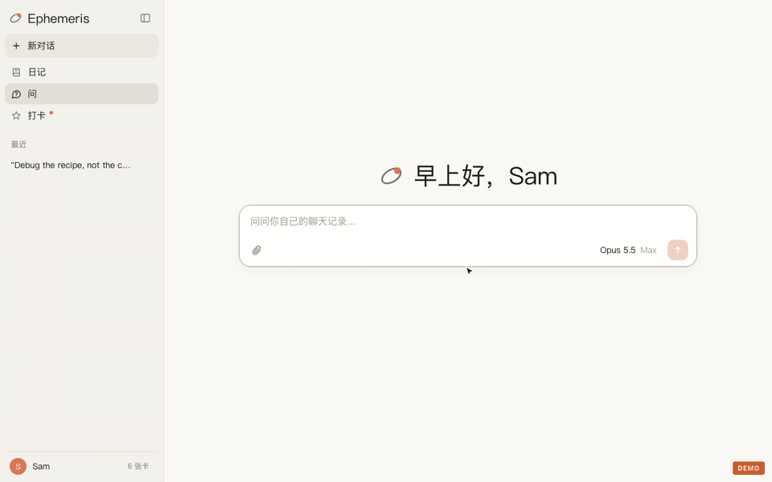

<p align="center"></p>

# Ephemeris

**English** | [中文](README.zh-CN.md)

Built by **[Kapozux](https://github.com/Kapozux)**

**Turn your long-running AI chat history into a local archive you can question in your own words.** Ephemeris reorganizes all your conversations from Claude, ChatGPT, Gemini, Claude Code and more by day instead of by window. It writes a diary entry every day, keeps a ledger of the things you keep working on, and gives you **Ask**: chat with your own past, and it digs through the original records before answering. Every conclusion comes with a timestamped quote; click it to jump straight back to that message.

<p align="center"><br><sub>Demo data: Sam is a fictional person. The answer is shown already finished; a real one takes about a minute.</sub></p>

*ἐφημερίς* is Greek for "a daily record". Astronomy later borrowed the word for the ephemeris, a table of where the celestial bodies are each day. This app does the same thing, except what it tracks is you.

## Why

Chat apps store history by **window**: one conversation can run for months, while a single day is scattered across a dozen windows. Some simple questions become impossible to answer:

- What was I actually doing on March 3?
- How long have I been working on this, and where did I leave off last time?
- Why did I decide to do it that way? Was the idea mine, or the AI's?

Ephemeris flips the axis: it first rebuilds each day from every window you touched that day, then strings the days together, and then lets you ask directly.

## What it does

### Ask: question your own records

- **A full-screen chat page**, modeled on claude.ai: each conversation has its own URL, you can stop an answer mid-stream, and several questions can run at once.
- **It looks things up instead of answering from impressions.** The model behind it only gets a read-only research tool: search your exact words, search evidence cards, read a single message, open a window, view a day, read your handwritten journal. It searches for several rounds and answers only once it has enough.
- **Every grounded sentence carries a source.** Below the answer it lists the quotes it relied on (which day, which window, which sentence); click "Go to quote" to jump to that message on that day's diary page. Citations that point to messages that don't exist are removed.
- **Evidence cards.** Every window is turned into cards: a one-line point plus a verbatim quote, tagged with who said it, the date, the topic, and the kind (decision, feeling, plan…). Each quote is checked word for word against the original message; cards that don't match are thrown away. Better one card too few than one that might be paraphrased or made up. Cards also have embeddings, so Ask can search by meaning.
- **Memory.** Like Claude's memory: "About you", "Your preferences", plus pages for each area of your life. Every entry says how recent it is and which card it came from. It is reorganized once a week; entries you add yourself must be kept by the model; pages you don't want it to see can be turned off. You can switch off "Use memory" in the chat menu, and that question will only search the raw records.
- **Hiding.** Pick a day, a window, or a handwritten journal entry, and Ask can no longer find it at all — the related cards, diary entries and memory items are blocked with it. The diary page still shows it as usual.
- **It can read files on your computer.** Logs, essays and PDFs that come up in your chats can be opened read-only (only in folders you allow, by default Documents and Downloads; hidden files, keys and databases are never read). Such citations are marked "File".
- **Attach files or folders to a question.** Click the paperclip and choose a file or a whole folder in Finder; only the path is handed to Ask, nothing is copied, and it reads the parts it needs, citing them with line numbers. You can also drag a file in or paste it (in that case a copy is stored locally).
- **Skills.** Certain kinds of questions have a dedicated method, written as a one-page guide under `skills/`; when such a question comes up, it reads the guide itself. There is one so far: testing whether "a thread running through everything" is real or stitched together (set the criteria first, sample over time and report ratios, look for counterexamples).
- **Charts in answers** (drawn in a sandbox with no network access).

Public benchmark: on [LoCoMo](https://snap-research.github.io/locomo/) (ACL 2024; 1,986 questions over long two-person conversations), Ask answers 94% of the four standard question types correctly, on par with putting the whole conversation into the model; using evidence cards alone gets 64.5%. On sourcing, the quoted evidence fully supports the answer 63% of the time and partly supports it 28% of the time.

### Diary and review

- **One diary entry per day.** Written from the messages you sent, in the first person: what you were busy with, what you finished, what is still open.
- **Topic ledger.** An ongoing thing (a project, an application, an assignment) is tracked across days. The diary notes "day 23 of X" or "back to X after 41 days". The Topics panel puts every thread on one shared timeline.
- **Review by window.** Pick a long conversation and see a one-line summary of each active day, plus the arc of the whole thread. When you keep chatting in that window, only new days and days whose content changed are added; old summaries stay as they were.
- **It reads your handwritten journal too.** Dated pages you write in Notion are pulled in read-only and shown above that day's AI diary, so the calendar can reach back years before your chat history begins. Anything Ephemeris appended to those pages is stripped first.
- **Two mood measures, kept separate.** "How the day went" comes from what you say yourself: check-ins or your handwritten journal. "How stuck you were" (0–4) comes from your AI chats. Experiments showed that chats capture the part where you're wrestling with problems, while the happy things mostly happen outside the chat, so the two are never merged into one number.
- **Full-screen check-in page.** Tap a word, optionally write a line, save. You can log several moments a day and fill in earlier days. After each check-in you get a short reply that knows what you've been busy with lately. The month view has a mood-composition bar, a one-star-per-day calendar, a mood constellation and a one-sentence summary.
- **Topic river.** All topics are grouped into a few broad categories, and a weekly chart shows how your energy flows between them.
- **Full-text search** across every message you've sent.
- **Runs automatically every day at 13:15.** It reads new Claude Code / Cursor / Codex sessions, pulls new conversations from claude.ai, writes any missing diary entries (not today's — the day isn't over yet), and makes evidence cards for windows with new messages. If the computer is asleep at that time, it catches up as soon as it wakes. The "Sync now" button runs the same pipeline.
- **It doubles as a backup of your chat history.** Append-only: if a conversation disappears or empties upstream, nothing is deleted locally, and the original export files are kept forever. If the same window was stored twice, the extra copy is moved to an archive table, not deleted.
- **Export.** Export a single window as Markdown, or the whole library; there's also a "handoff pack" that packages your background for a new AI account.
- **Optional Notion sync.** Diary entries are written to a Notion database. If you already wrote a page for that day yourself, it appends after your text without touching it.
- **Privacy lock.** Set a password (Touch ID also works on a Mac): the moment you leave the page it locks, and the server locks with it.

**A diary entry is written once and then left alone.** New features build on existing entries; old entries are never rewritten in bulk.

## How it works

```
claude.ai (daily sync) ──┐
Claude Code / Cursor /   ├─> index.py ──> chats.db ──┬─> diary.py ──> ledger.py
  Codex (local logs)     │   dedupe,      SQLite +   │   one entry    match the day's
Manual import ───────────┘   split by day FTS5       │   per day      work to topics
                                                     ├─> cards.py: evidence cards (quotes checked verbatim) + embeddings
                                                     ├─> memory.py: memory (reorganized weekly)
                                                     └─> qa.py ──> look.py (read-only research tool)
                                                         Ask       hidden items are filtered out here
                                          │
                                          ├─> web UI (localhost:5055)
                                          └─> to_notion.py ─> Notion
```

- **What counts as a day**: UTC+8, and a day doesn't end until 4 a.m., so late-night chats belong to the day they started.
- **Window identity**: claude.ai's conversation uuid. For sources without a stable id, it falls back to a fingerprint of the first message.
- **Each diary entry** looks at the previous entry and the topic ledger, so it can pick up where yesterday left off.
- **What the model reads**: everything you typed yourself is kept; pasted material (articles, code, transcripts, AI replies) keeps only a few hundred characters from the start and end, so one long paste can't crowd out your own words.
- **Two voices.** The diary and reviews are a mirror: what you did and how you said you felt, no advice. Check-in replies are companionship: specific, on your side, sometimes with one small suggestion.
- **Matching the day's work to existing topics** is a separate, very small model call. Stuffed into the diary prompt, the topics would snowball. "Day N" and "how long since" are computed by code; the model only makes judgments.
- **Who said what is never guessed.** Every platform's export already marks "you sent this" vs. "the AI replied", and that is recorded as-is; a card's speaker is inherited directly from its message.
- **Material is budgeted by source.** When writing the diary, AI chats get 80%, coding tools 10%, and Ask conversations 10%, so a day of heavy coding doesn't crowd out everything else.

## Supported imports

- claude.ai: automatic daily sync, or run the bundled `export_claude.js` in the browser console to export JSON / Markdown
- Single-window transcripts from Claude's incognito mode
- Gemini `sess_*.md` exports
- Gemini Apps `MyActivity.json` from Google Takeout
- The .zip from ChatGPT's official "Export data"
- The .zip from DeepSeek web (chat.deepseek.com → Settings → Data management → Export all chats)
- Markdown exported from Google AI Studio
- Local Claude Code, Cursor and Codex sessions (read automatically every day, no export needed)
- claude.ai windows that don't show up in your list (e.g. incognito windows): paste the link under Data sources and it's pulled with the daily sync
- claude.ai attachments are recorded by name only ("[Attachment: name]"); their contents aren't stored
- LobeHub export files

Importing the same data twice is fine. Messages are deduplicated, and only days whose content actually changed get their diary rewritten.

## Install

Requirements: a Mac or Windows computer, Python 3.9+, and a key from one model provider (DeepSeek / Gemini / OpenRouter / Bailian, any one), or Claude Code installed locally.
Chrome or Edge is only needed for the automatic claude.ai sync.

**Mac**

```bash
git clone https://github.com/Kapozux/Ephemeris.git
cd Ephemeris
./run.sh                    # first run installs what it needs (a minute or two), then opens http://localhost:5055
```

Prefer not to use the terminal: double-click `启动 Ephemeris.command` in Finder (keep that window open — closing it stops Ephemeris).

**Windows**

1. Install Python from [python.org](https://www.python.org/downloads/). On the first screen of the installer, be sure to check "Add python.exe to PATH".
2. Download this repo (on GitHub: Code → Download ZIP, unzip it to e.g. `D:\Ephemeris`; or `git clone`).
3. Double-click `run.bat`. The first run installs what it needs (a minute or two), then opens http://localhost:5055.
   Keep that black window open — closing it stops Ephemeris. Next time, just double-click `run.bat` again.

The first time you open it, you'll see a "Get started" page:

1. **Choose the model that writes your diary** — you only need that provider's key:
   - **DeepSeek** (choose this if DeepSeek is all you have): create an API key at [platform.deepseek.com](https://platform.deepseek.com/api_keys), add a little credit, and paste it in.
     Diary, evidence cards and Ask all go through it; for deep answers it calls tools itself to search your chats. DeepSeek has no embedding model, so Ask searches by keyword.
   - **Claude Code**: if `claude` is installed and logged in locally, no key is needed; it uses your subscription.
   - **Gemini** / **OpenRouter** / **Bailian (Qwen)**: paste the corresponding key.
   Keys are verified with the provider before saving (free); a wrong key or one with no balance won't be saved.
2. What the diary should call you (optional).
3. **Bring in your chat history**: pick export files right on this page (DeepSeek / ChatGPT / Claude / Gemini .zip files all work, no need to unzip),
   or paste your claude.ai sessionKey to have it download automatically every day.

Everything you fill in is written only to the local `.env`. Once you're set up, this page no longer appears.

Fields in `.env` (anything you filled in on the page is already handled; leave out what you don't use):

| Field | Purpose |
| --- | --- |
| `EPHEMERIS_PROVIDER` | Which provider to use: `deepseek` / `claude` / `gemini` / `openrouter` / `dashscope` (chosen on the Get started page). Anything other than `claude` never touches your local Claude Code |
| `DEEPSEEK_API_KEY` | Official DeepSeek API. `EPHEMERIS_DEEPSEEK_MODEL` changes the default model (default `deepseek-v4-flash`); `EPHEMERIS_CHEAP_PARALLEL` caps concurrent requests (default 16) |
| `GEMINI_API_KEY` | Gemini (used for diary and reviews when there's no other provider; when present, politically sensitive content goes only to it) |
| `DASHSCOPE_API_KEY` | Alibaba Cloud Bailian (for DeepSeek hosted there) |
| `EPHEMERIS_UTC_OFFSET` | Your time zone (hours, default 8) |
| `CLAUDE_SESSION_KEY` | Daily claude.ai sync (a browser cookie); `CLAUDE_ORG_ID` is optional |
| `DIARY_NAME` | What the diary prompt calls you |
| `NOTION_TOKEN`, `NOTION_DIARY_DS` | Notion sync (internal integration secret + the database's data_source_id) |
| `OPENROUTER_API_KEY` | OpenRouter: DeepSeek / Gemini via OpenRouter, evidence-card embeddings, and Settings → Handoff pack |
| `EPHEMERIS_LLM` | `gemini` (default) or `verbatim` (follow Verbatim's model routing; requires Verbatim next to it) |

> All model calls go through `llm.py`: if local Claude Code is available it goes first; otherwise DeepSeek (Bailian / official / OpenRouter in rotation).
> With Gemini configured, politically sensitive content goes only to Gemini, and DeepSeek failures fall back to Gemini; with only DeepSeek, everything goes to it and rate limits are retried after a short wait.
> If [Verbatim](https://github.com/Kapozux/_Verbatim_)'s `getAudio/` sits next to it, missing keys are borrowed from Verbatim and costs are logged in its ledger; it works fine without it.

Only requests from this local page are accepted: requests from other websites or domains are rejected, so no web page can quietly make it sync, write diaries, or change your keys.

## Privacy

Everything stays on your machine: the database, diary, check-ins, handwritten journal, imported files, Chrome login state, and `.env`. `.gitignore` is an **allowlist**: only source code goes into the repo.

But it is **not fully offline**: writing the diary, making evidence cards and Ask all call a model, and the content involved is sent to the provider you configured — for the diary, the messages *you* sent that day; for cards, a section of that window; for Ask, the quotes it found. Evidence-card embeddings go through Google's embedding service. To keep something out of Ask, hide it.

## Cost

- Diary: about 1 cent a day with `gemini-3.5-flash-lite` (one call to write the entry, one to match topics).
- Evidence cards: large batch imports automatically use cheap DeepSeek; normally it's just a few windows a day.
- Ask: one question takes several rounds of searching, so it's the most expensive part. With local Claude Code it uses your subscription at no extra cost.
- Buttons that cost money (Backfill, Sync now, Notion sync) ask first, stating the scope and a rough cost.
